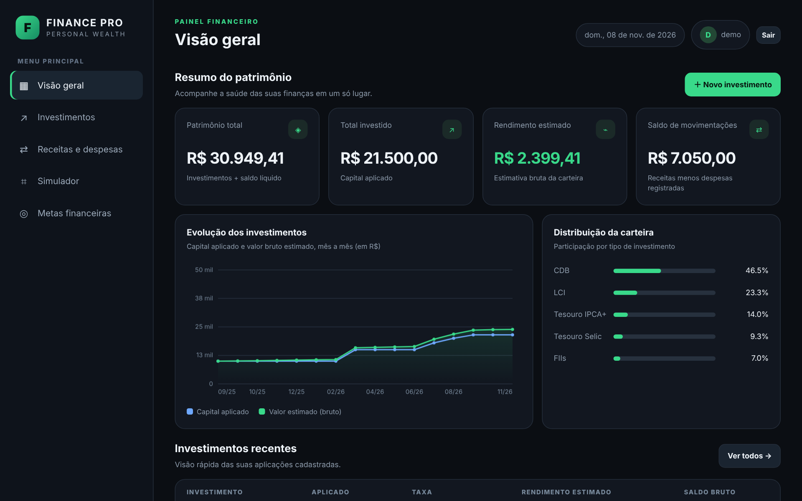
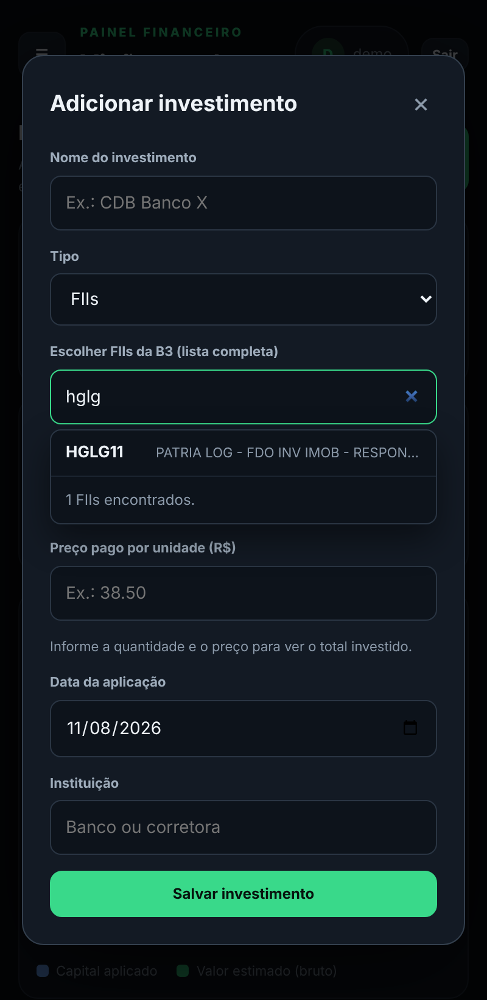

# VITAL GARANHAO

Aplicativo web de **controle financeiro pessoal**: investimentos, receitas e despesas, metas e simulador, com **login e cadastro** e dados separados por usuário.

**Site no ar:** https://ganaves.pythonanywhere.com

Abra o link, clique em **Criar conta** e use. Não precisa instalar nada.
Não coloque dados financeiros reais: é uma versão de demonstração.



## O que o app faz

- **Painel** com patrimônio total, rendimento estimado, gráfico de evolução mês a mês e distribuição da carteira.
- **Renda fixa** (CDB, LCI, LCA, Tesouro, Poupança): rendimento por CDI, IPCA+ ou taxa fixa, com **IR e IOF** calculados.
- **Renda variável** (ações, FIIs, ETFs e BDRs): lista completa da B3 para escolher o ativo, com quantidade, preço pago e **cotação atual, lucro e prejuízo**.
- **Proventos** (dividendos, JCP e rendimentos): média mensal e total recebido de cada ativo, gráfico dos últimos 12 meses e o que ainda vai cair.
- **Meta de renda passiva:** defina quanto quer receber por mês e acompanhe o progresso.
- **Recuperação de senha** por código (veja Segurança).
- **Receitas e despesas** por categoria, com o saldo do mês.
- **Metas financeiras** que acompanham o total da carteira sozinhas, se você quiser.
- **Simulador** de juros compostos.
- **Editar e excluir** qualquer registro.
- Funciona bem no **celular**.



## Versões

| Versão | O que mudou |
|--------|-------------|
| **v1.7** | Gráfico de proventos por mês, meta de renda passiva e recuperação de senha |
| **v1.6** | Aba **Proventos**: quanto cada ativo paga por mês e quanto você já recebeu |
| **v1.5** | Cotações ao vivo (brapi.dev) com lucro e prejuízo em ações, FIIs, ETFs e BDRs |
| **v1.4** | Renda variável pede quantidade e preço pago; some taxa, indexador e vencimento |
| **v1.3** | Lista da B3 (ações, FIIs, ETFs e BDRs) para escolher o ativo |
| **v1.2** | Link do site no README |
| **v1.1** | Publicação online (PythonAnywhere) e conta de demonstração |
| **v1.0** | Primeira versão: Flask + SQLite, login, metas automáticas, edição, impostos e gráfico |

Detalhes de cada versão no [CHANGELOG](CHANGELOG.md).

## Tecnologias

- **Python 3 + Flask**: servidor, login, API e todos os cálculos (rendimento, IR, IOF, simulador).
- **SQLite**: banco de dados em um único arquivo.
- **HTML, CSS e JavaScript** puros: só cuidam da tela (inclui o gráfico, desenhado em canvas).
- **PythonAnywhere**: hospedagem. O GitHub guarda o código.

## Como rodar no seu computador (opcional)

Só precisa disto se quiser mexer no código. Para apenas usar o site, use o link do topo.
Antes, instale o Python (https://www.python.org) e abra o terminal dentro da pasta do projeto.

```bash
python -m venv .venv
# Windows:  .venv\Scripts\activate
# Mac/Linux: source .venv/bin/activate

pip install -r requirements.txt
python app.py
```

Abra http://localhost:5000. Na primeira vez, clique em **Criar conta**.

Para ver o app já cheio de dados de exemplo: `python seed_demo.py USUARIO SENHA` cria uma conta de demonstração.

## Colocar no ar

O passo a passo (GitHub + PythonAnywhere, com um script que faz o trabalho pesado) está no **[DEPLOY.md](DEPLOY.md)**.
Em outros servidores é preciso: HTTPS com `HTTPS=1`, um servidor de produção (por exemplo `gunicorn app:app`), uma `SECRET_KEY` própria e backup do `vital.db`.

## Regras usadas nos cálculos

- **LCI, LCA e Poupança:** isentos de IR e IOF (pessoa física).
- **Demais investimentos de renda fixa:** IR pela tabela regressiva (22,5% até 180 dias, 20% até 360, 17,5% até 720, 15% acima) e IOF pela tabela oficial nos primeiros 29 dias.
- **Proventos:** vêm da brapi.dev e só contam o que foi pago a quem já tinha o ativo na data com. Média mensal = soma dos últimos 12 meses ÷ 12. Podem divergir do que a corretora creditou.
- **Renda variável:** valor atual = quantidade × cotação (guardada por 15 minutos). Sem IR/IOF nessa conta. Se a cotação não vier, o ativo fica pelo valor pago.
- A brapi libera poucos ativos sem cadastro; para a carteira toda, crie um token grátis em https://brapi.dev e defina `BRAPI_TOKEN`.
- A lista da B3 (`b3_ativos.json`, cadastro de 05/11/2026) é fixa: ativos novos só entram quando o arquivo for atualizado.

## Segurança

- Senhas guardadas com hash (nunca o texto da senha).
- Cookie de sessão protegido (HttpOnly, SameSite) e válido por 7 dias.
- Bloqueio temporário após 5 senhas erradas em 5 minutos (vale também para a recuperação).
- **Recuperação de senha:** ao criar a conta aparece um código (XXXX-XXXX-XXXX-XXXX), mostrado uma única vez; só o hash dele fica guardado. Em "Esqueci minha senha", usuário + código definem uma senha nova e o código usado deixa de valer. Contas antigas ou código perdido: botão **Recuperação** no topo gera um novo, pedindo a senha. Não usa e-mail.
- Cada consulta é filtrada pelo usuário logado, então ninguém acessa dados de outra conta.
- `vital.db` e `secret.key` ficam só no servidor e nunca vão para o GitHub.

## Estrutura

```
vital-garanhao/
├── app.py                    # servidor Flask, login, API, cálculos e banco SQLite
├── b3_ativos.json            # lista fixa de ações, FIIs, ETFs e BDRs da B3
├── requirements.txt
├── CHANGELOG.md              # histórico de versões
├── DEPLOY.md                 # passo a passo para publicar
├── setup_pythonanywhere.sh   # instala e configura o site no PythonAnywhere
├── seed_demo.py              # cria uma conta de demonstração
├── docs/                     # imagens do README
├── templates/
│   ├── index.html            # painel (exige login)
│   └── login.html            # entrar / criar conta
├── vital.db                  # banco de dados (criado na primeira execução)
└── secret.key                # chave que assina o login (criada na primeira execução)
```

<details>
<summary><b>Rotas da API</b></summary>

| Método | Rota | O que faz |
|--------|------|-----------|
| POST | `/api/register` | Cria conta e já entra |
| POST | `/api/login` | Entra |
| POST | `/api/logout` | Sai |
| GET | `/api/summary` | Tudo já calculado do usuário logado |
| GET | `/api/assets` | Lista de ações, FIIs, ETFs e BDRs da B3 |
| POST | `/api/investments` | Cadastra investimento |
| PUT | `/api/investments/<id>` | Edita investimento |
| DELETE | `/api/investments/<id>` | Exclui investimento |
| POST | `/api/transactions` | Cadastra receita/despesa |
| PUT | `/api/transactions/<id>` | Edita movimentação |
| DELETE | `/api/transactions/<id>` | Exclui movimentação |
| POST | `/api/goals` | Cria meta |
| PUT | `/api/goals/<id>` | Edita meta |
| PATCH | `/api/goals/<id>` | Liga/desliga o acompanhamento automático da meta |
| DELETE | `/api/goals/<id>` | Exclui meta |
| POST | `/api/recover` | Define nova senha com o código de recuperação |
| POST | `/api/recovery-code` | Gera um novo código de recuperação (logado, pede a senha) |
| PUT | `/api/income-goal` | Define a meta de renda passiva mensal |
| PUT | `/api/settings` | Altera o CDI de referência |
| POST | `/api/simulate` | Simulador de juros compostos |

Todas, exceto cadastro e login, exigem estar logado.

</details>

> Versão demonstrativa. Os cálculos de IR e IOF são estimativas simplificadas e não são recomendação de investimento.
